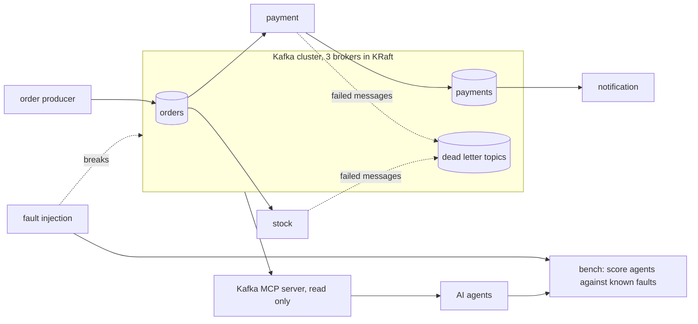

# kafka-sandbox

[](https://github.com/Keil-ENZO/kafka-sandbox/actions/workflows/ci.yml)
[](LICENSE)

A local Kafka playground that breaks on command, built to learn Kafka the hard way and to find out where AI agents actually help a platform team.

**Status:** early setup. Nothing runs yet.

## Why

A healthy cluster teaches nothing. This sandbox runs a small event-driven system, injects known faults into it, and scores AI agents on whether they find the real cause.

## Planned architecture



- **Cluster:** 3 Kafka brokers in KRaft mode, Schema Registry, AKHQ. Confluent Platform 8.3.3, community images.
- **Services:** a fake e-commerce flow in Python with the official `confluent-kafka` client.
- **Faults:** scripted failures, each with a ground-truth sheet: symptoms, cause, fix.
- **Agents:** they read the cluster through an MCP server. Read only first, writes later and only with human approval.
- **Bench:** every agent is scored on the known faults. No score, no claim.

## Roadmap

| Step | Content |
|---|---|
| 1. Cluster | 3 brokers, AKHQ, Schema Registry |
| 2. Fake business | producer, three consumers, dead letter topics |
| 3. Faults | metrics, fault harness, cluster, consumer and data faults |
| 4. MCP server | read the cluster, messages, schemas, metrics and logs |
| 5. First agents | explainer, on-call diagnosis, topic governance, the bench |
| 6. Agents that act | dead letter triage, schema impact, flow map, topic creation |

## Layout

| Folder | Content |
|---|---|
| `infra/` | Docker Compose for the cluster and its tooling |
| `services/` | the Python services of the fake business |
| `schemas/` | event schemas |
| `faults/` | one folder per fault: inject, repair, ground truth |
| `mcp/` | the Kafka MCP server |
| `agents/` | the agents |
| `bench/` | the evaluation bench and its results |
| `docs/` | notes on how things work |

## Development

Requires Python 3.12 and [uv](https://docs.astral.sh/uv/).

```bash
uv sync
make lint
make test
```

## License

MIT
